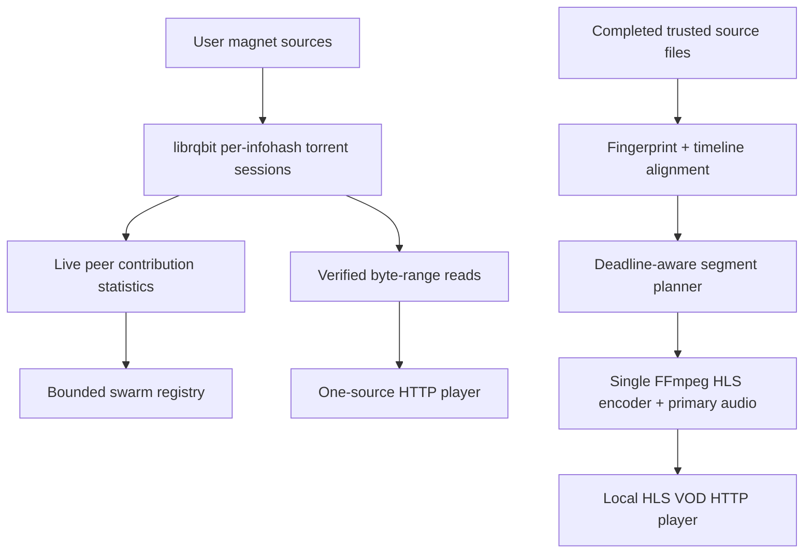

# my_streamio

Local-first Rust torrent source manager and multi-encoding media pipeline research prototype.

> **Development prototype; not a finished Stremio replacement.**
> Torrent source addition, verified-byte Range endpoints, peer diagnostics,
> *offline* multiple-encoding HLS composition, fingerprint alignment, piece
> verification and a bounded swarm registry are implemented in code. They are
> **not** a fully integrated real-time multi-swarm streaming service yet.

## The idea

One film can be distributed through several **independent torrent swarms**
with different Infohashes or encodings. BitTorrent already downloads in
parallel from peers within one swarm. This project experiments with
finding usable peers across independently managed swarms and converting
**verified, scene-aligned video intervals** into one consistent playback
stream. It never mixes unrelated compressed torrent pieces.



Note that `I` is currently a separately tested planning core, **not yet
connected** to live verified torrent reads or dynamic HLS output. The
offline HLS path uses complete trusted local files; it is not a live
source-switching claim.

## Requirements

- Rust toolchain from `rust-toolchain.toml` (currently **1.100.0**).
- macOS Apple Silicon or Linux ARM64/x86_64.
- FFmpeg/ffprobe with libx264/libx265 to exercise HLS fixtures.
- Only legally distributable or self-created media as source inputs.

## Start the local daemon

```sh
cargo run --bin my-streamio-daemon
```

Visit <http://127.0.0.1:3031> in your browser. The daemon only binds
to `127.0.0.1`, not the public network. It defaults to local `./data`.

Environment configuration:

| Setting | Default | Description |
|---|---|---|
| `STREAMIO_PORT` | `3031` | HTTP port on loopback |
| `STREAMIO_DATA_DIR` | `./data` | Torrent session and verified data root |
| `STREAMIO_MEDIA_DIR` | same as data root | Offline HLS VOD output root |
| `STREAMIO_MAX_SWARMS` | `32` | Maximum registered Infohashes (1..128) |

A few example endpoints:

```sh
curl -fsS http://127.0.0.1:3031/healthz
curl -fsS http://127.0.0.1:3031/api/v1/sources
curl -fsS http://127.0.0.1:3031/api/v1/swarms
```

The browser has a magnet source input (externally contacts trackers/peers),
source file listing, single-source video preview and peer statistics.
Actual useful peer counts come from differences in per-peer checked-piece
counters. Received network bytes are not necessarily verified bytes.

## Test the offline mixed-encoding HLS path

```sh
sh tests/integration/hls.sh
```

This generates synthetic H.264 and HEVC clips, mixes a 3s H.264 → 3s HEVC
→ 3s H.264 timeline into an H.264/AAC HLS playlist using **one continuous
primary audio track**, probes the output and checks full FFmpeg decode.

For native HLS playback in Safari, run:

```sh
STREAMIO_MEDIA_DIR="$PWD/tests/fixtures/generated" \
STREAMIO_DATA_DIR="$PWD/tests/fixtures/generated/torrents" \
cargo run --bin my-streamio-daemon
```

Then open <http://127.0.0.1:3031> and play program ID
`integration-switch`. Running the shell script successfully does **not**
prove browser playback or the Mac VideoToolbox hardware path.

## Test the native M5 media path

On the actual M5 Mac, with FFmpeg installed:

```sh
bash scripts/benchmark_m5.sh
```

This compares CPU libx264 encoding against VideoToolbox when available and
writes metadata and timing logs. Results depend on FFmpeg build, codecs,
power state and device capabilities; no M5 benchmark has been recorded in
this repository.

## Architecture and status

See [the documentation index](docs/README.md), [architecture](docs/ARCHITECTURE.md),
[exact implementation status](docs/IMPLEMENTATION_STATUS.md),
[security review scope](docs/phases/11-SECURITY.md), and
[release gates](docs/RELEASE_CHECKLIST.md).

Outstanding product-critical tasks:

- Real controlled torrent seeding with actual verified Range video playback/seek.
- Actual active per-swarm scheduling and reusable cross-Infohash on-disk
  verified cache, including BEP52/v2 and multi-file proofs.
- Frame fingerprint sampling directly from incomplete torrents, edit-aware
  piecewise alignment and live timeline switching.
- Dynamic HLS segments with backpressure, retries and uninterrupted audio.
- Native M5 benchmarking, Linux Docker runtime validation and browser tests.
- Full CI passing at the **same Git commit** before any release.

## CI and contribution

`.gitlab-ci.yml` uses an existing GitLab Runner named `Oracle-A1-ARM64`
for smoke, Rust and synthetic offline-HLS checks. These jobs can be queued
when the self-hosted Runner is busy. Linux CI cannot prove macOS VideoToolbox.

All implementation work is currently in stacked **Draft merge requests**,
not merged into `main`. Each Phase needs actual CI logs and real
reproducible acceptance tests, not just a source commit.

## Safety

Never expose this unauthenticated development API to a public network.
The local API does not prevent peer discovery from connecting to external
Internet systems once you supply a magnet. Explicit tracker policies,
resource limits and media parsing hardening are still under review.
Do not use the project to distribute media without the necessary rights.
