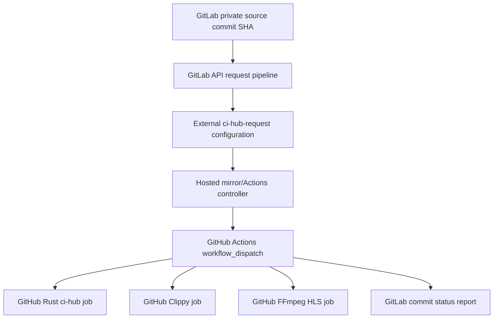

# GitHub Actions-only CI for my_streamio

**Source control:** private GitLab [blond11qq/my_streamio](https://gitlab.com/blond11qq/my_streamio).  
**Build/test provider:** GitHub Actions ONLY.  
**Public execution mirror:** [giinii06/my_streamio-ci-mirror](https://github.com/giinii06/my_streamio-ci-mirror).  
**Reusable Rust workflow:** `giinii06/ci-hub/.github/workflows/ci.yml@v1`.

## Current effective configuration

GitLab project-level `ci_config_path` is currently
`.gitlab/ci-hub-request.yml@blond11qq/ci-hub-smoke`.

This **external** configuration controls any GitLab API pipeline requests,
overriding the now-removed repository `.gitlab-ci.yml`. It provides
`dispatch_github_actions` as a downstream GitHub Actions request. It
does NOT run `cargo build`, `cargo test`, Clippy, FFmpeg or other
application checks on GitLab's runners.

The GitHub mirror's default branch has
`.github/workflows/gitlab-request.yml`, invoked by the hosted
controller using `workflow_dispatch` on an exact requested source
commit SHA. It supports `stack: rust` and an optional `hls: true`.

When Rust/HLS are requested, the GitHub-side jobs are independent:

- `build`: reusable Rust `ci-hub` workflow.
- `rust-policy`: `cargo clippy --locked --workspace --all-targets -- -D warnings`.
- `media-hls`: FFmpeg install and `sh tests/integration/hls.sh`.

These are GitHub-hosted Ubuntu jobs, not GitLab ARM64 jobs. The branch
also contains `.github/workflows/gitlab-bridge.yml` for GitHub-native
push/manual checks after that branch is actually mirrored. **Pushing a
branch is not necessary to invoke the existing GitLab API dispatch
bridge**: the hosted controller can transfer the requested commit to
GitHub under its existing established policy.

## Flow

The GitLab API request pipeline can appear successful as soon as its
dispatch task finishes. The separate `github-actions/ci-hub-request`
status is the relevant reported execution result. Inspect its GitHub
run URL to confirm which jobs actually ran before claiming verification.

## How to run

1. Commit the application and `Cargo.lock` to a GitLab review branch.
2. Use the GitLab API **Create pipeline** for that exact ref.
3. Verify the returned pipeline's SHA equals the branch HEAD.
4. Query commit statuses for the same SHA, filtered to
   `github-actions/ci-hub-request` and the new pipeline ID.
5. Open the linked GitHub Actions run. Verify each required job:
   Rust build/test, Clippy, and synthetic offline HLS. Check that
   the tested commit SHA is the same. Record skipped/manual
   and missing jobs separately.
6. Keep the MR in Draft until all required checks genuinely pass.

The default-branch GitHub `gitlab-bridge.yml` uses `stack: docs`
for legacy main-only push checks. A *docs-only* success cannot replace
the required Rust/HLS checks for implementation branches.

## Explicitly excluded

- **No Oracle ARM64 project Runner**, GitLab-hosted Runner or Docker
  executor is used to build or test this project.
- **No `.gitlab-ci.yml`** is kept in the source tree.
- No GitLab CI environment variable or token should be copied into
  public GitHub source, logs or a Git commit.
- Do not change GitLab project `ci_config_path`, mirroring settings,
  repository visibility, or GitHub secrets while making this cleanup.
- Native Apple M5 VideoToolbox still requires a separate macOS test;
  Linux GitHub jobs cannot certify it.

## Troubleshooting

**GitLab pipeline succeeds but no Github jobs appear:** inspect
`dispatch_github_actions`, the exact SHA's
`github-actions/ci-hub-request` context and linked run. The first is
a request/dispatch step, not the Rust build.

**Only a docs job runs:** the controller or caller selected `stack:
docs`; request `stack: rust` with HLS enabled through the existing
GitHub dispatch workflow, rather than claiming that the docs job
passed the Rust suite. Updating hosted controller settings is outside
the repository change and requires independent permission.

**Why not delete GitLab pipelines entirely?** In this architecture,
the GitLab API pipeline is a lightweight dispatch and status bridge.
Using GitHub Actions as the sole *execution provider* still requires
that existing bridge unless another authorized trigger is implemented.

See [the phase plan](plans/github-actions-only/README.md) and
[the historical GitLab Runner bootstrap](CI_RUNNER.md).
