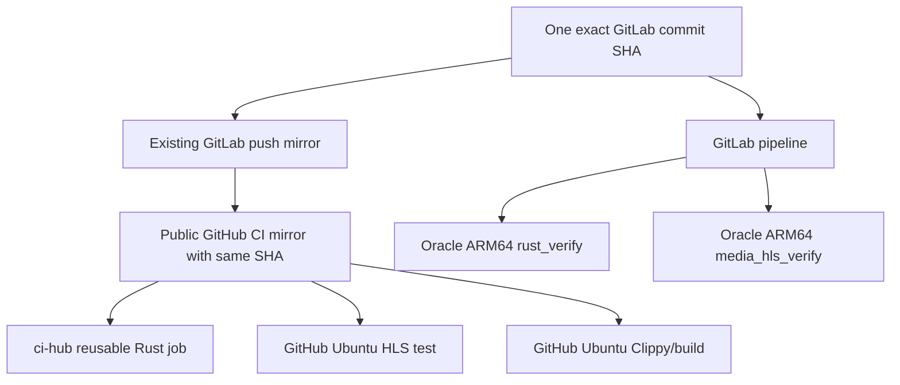

# GitLab + GitHub parallel CI for my_streamio

## Existing upstream CI bridge

- **Source of truth:** private GitLab project [blond11qq/my_streamio](https://gitlab.com/blond11qq/my_streamio).
- **Public CI mirror:** [giinii06/my_streamio-ci-mirror](https://github.com/giinii06/my_streamio-ci-mirror).
- **Reusable GitHub CI contract:** `giinii06/ci-hub/.github/workflows/ci.yml@v1`, proven by the `ci-hub-smoke` GitLab test project.
- GitLab `main` already includes `.github/workflows/gitlab-bridge.yml`, but it currently requests `stack: docs` and runs only for `main`.
- The repository's existing `main` README documents GitLab **protected `main` + tags** mirroring only. This is NOT automatic mirroring of GitLab feature branches.

## How parallel execution works after mirroring

`rust_verify` and `media_hls_verify` on GitLab use independent DAG scheduling through `needs: []`. They are **eligible to run together**, but an Oracle project runner with one execution slot will still serialize execution. GitHub `rust-hub`, `media-hls` and `rust-policy` have no dependencies and can run on three separate GitHub-hosted runners.

The GitHub caller workflow has `workflow_dispatch` for manual re-runs, only `contents: read` permissions and no repository secrets.

## Crucial requirement for GitLab feature-branch validation

The GitLab feature branch must exist on the GitHub mirror **with the same commit SHA**, and the workflow must already be present on that branch. Merely adding the caller workflow to GitLab does not activate GitHub Actions.

Preferred: adjust the **existing configured push-mirror rules** in GitLab project Settings → Repository → Mirroring repositories so the intended test branch(es) are mirrored. Do not create another mirror target or expose all private development branches accidentally. If that GitLab mirror allows *only protected refs*, protecting the specifically approved CI ref may be an alternative subject to repository permissions. The existing GitLab connector cannot edit the push-mirror configuration or the GitHub repository.

For a one-off test, a user with authorized access to the GitHub mirror can push the CI branch there from a trusted local checkout using existing authentication (no token in Git). Avoid force-pushing the public GitHub mirror. Public mirrors expose all pushed source code.

## Required checks before declaring success

1. GitLab source SHA and GitHub Actions `github.sha` must be **identical**.
2. GitLab `rust_verify` and `media_hls_verify` must both have actual finished **success** jobs (not `created`/`pending`/`skipped`).
3. GitHub `rust-hub`, `media-hls`, `rust-policy` must independently finish successfully on that SHA.
4. Compare job logs and identify platform differences (GitLab Linux ARM64 vs GitHub Ubuntu x86_64). Do not infer M5 hardware acceleration from either.
5. An offline HLS test does not yet prove live multi-swarm torrent streaming.

## Triggering and checking status

- GitLab CI: navigate to the commit pipeline for the implementation/CI branch.
- GitHub Actions: [GitLab CI Bridge actions](https://github.com/giinii06/my_streamio-ci-mirror/actions/workflows/gitlab-bridge.yml). Choose **Run workflow** for the branch when it has actually been mirrored; otherwise no matching source exists.
- If the GitHub mirror only has `main`, its existing `stack: docs` workflow verifies that `main` commit only and **cannot** be counted as a test of the feature branch.

Until both sides report results for the same SHA, status is **configured in GitLab but GitHub execution unverified**.
